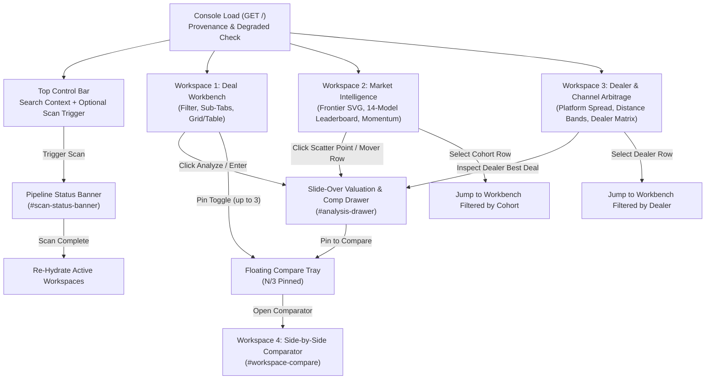

# Bay Area EV Market Intelligence Console — UI/UX & Interaction Architecture (`v2-market-intelligence`)

> **Owner:** Principal UI/UX & Interaction Architect (`@ux-architect`)
> **Companion Specifications:** [`docs/MARKET_ANALYSIS_SPEC.md`](MARKET_ANALYSIS_SPEC.md), `docs/DESIGN_SYSTEM.md` (`@product-designer`)
> **Target Module:** `src/dashboard/` (`app.py`, `queries.py`, `templates.py`, `sample_data.py`, `static/`)
> **Runtime Policy:** Zero external CDN runtime dependencies; zero emojis across specifications, templates, icons, and UI copy.

---

## 1. First-Principles UX Foundation & Non-Negotiable Constraints

The v1 dashboard functioned as a single-feed listing browser relying on runtime CDNs (`cdn.tailwindcss.com`, `unpkg.com/htmx.org`), emoji markers, hardcoded local URLs, and modal-only details. The `v2-market-intelligence` console elevates the application into a deterministic **4-Workspace Quantitative Decision Console** built around four first-principles invariants:

1. **Signal-to-Noise Density & Progressive Disclosure**:
   - Every card cell, table column, badge, and chart axis must justify its screen real estate against an explicit buyer or analyst decision.
   - Deep quantitative breakdowns (cohort percentile distribution, OLS/depreciation curves, leverage sub-scores, NHTSA recall campaign narratives) live inside the slide-over Valuation & Comp Drawer (`id="analysis-drawer"`) and dedicated analytical workspaces rather than cluttering initial triage cards.
2. **Complete 5-State Determinism (`Empty`, `Loading`, `Nominal`, `Degraded`, `Error`)**:
   - Every workspace, panel, and drawer explicitly models all five states.
   - Loading states use geometry-matched placeholders that preserve container dimensions to achieve zero Cumulative Layout Shift (`CLS = 0`).
   - Error recovery always preserves operator context (active workspace, sub-tab, filter controls, sort key, and pinned comparison IDs).
3. **Keyboard-First & Accessible by Construction (WCAG 2.2 AA)**:
   - Semantic HTML5 landmarks, roving `tabindex` tab navigation, global filter shortcuts (`/` and `Cmd/Ctrl+K`), `Escape` focus restoration, explicit `<label for="...">` associations, `aria-live="polite"` status announcements, `font-variant-numeric: tabular-nums` alignment on all numeric metrics, and minimum contrast ratios (`4.5:1` body text, `3.0:1` large text, interactive boundaries, and SVG data strokes).
4. **Zero-CDN & Zero-Emoji Hygiene**:
   - All styling, layout, interactivity, and data visualization ship locally via pure HTML5, self-contained CSS (served via local static asset or SSR inline stylesheet), vanilla ES modules (`<script type="module">`), and pure inline SVG geometry/icons.
   - External requests to Tailwind CDN, HTMX CDN, third-party font CDNs, or icon libraries are strictly prohibited.
   - Zero emojis are permitted anywhere in HTML output, JS strings, SVG labels, or documentation. All visual indicators use crisp inline `<svg>` vector icons (`aria-hidden="true"` paired with text or `aria-label`) or explicit text tokens.

---

## 2. Target Operator Personas & Core Decision Journeys

### 2.1 Operator Personas

| Attribute | Persona A: Bay Area EV Value Buyer | Persona B: Quantitative Market & Arbitrage Analyst |
| :--- | :--- | :--- |
| **Profile** | Individual buyer shopping the `$20,000–$60,000` used BEV segment within `60 miles` of ZIP `94103` (San Francisco / Peninsula / East Bay / South Bay). | Analytical operator tracking market-wide EV depreciation cliffs across the 14 watchlist models (`Cars.com` and `CarGurus`). |
| **Primary Goal** | Identify a clean-title EV priced meaningfully below cohort fair market value (`p25` Buy-Zone), verify safety/EPA specs, confirm Used EV Tax Credit eligibility (`<= $25k`), and negotiate with confidence. | Quantify price-vs-mileage regression slopes, isolate price-cut velocity and stale-lot carrying friction (`DOM >= 30`), identify dealer/channel pricing arbitrage, and benchmark 3-year TCO across finalists. |
| **Key Questions Answered** | "Is this `$39,988` EQS 450+ genuinely cheap compared to peers, or risky? How much can I realistically offer? Does it have open recalls or crash complaints?" | "Which of the 14 models currently has the steepest discount below MSRP and highest `p25` liquidity? Are `CarGurus` listings cheaper than `Cars.com`? Do dealers 30–60 miles out discount deeper?" |
| **Cognitive Friction Risks** | Overwhelmed by raw VIN specs, hidden salvage/accident penalties, unclear MSRP baselines, or stale prices without historical context. | Misreading thin sample cohorts (`n < 3`), comparing vehicles with mismatched mileage/year curves, or losing filter state across tabs. |

### 2.2 Core Decision Journeys



1. **Journey A — Daily Triage & Conviction Shortlisting**:
   - Operator lands on `Deal Workbench` (`id="workspace-workbench"`), reviews the 4-card KPI strip, switches sub-tabs (`excellent`, `drops`), presses `/` to jump to `#search-input`, inspects ranked Grid cards or switches to Sortable Table for rapid numeric scanning, optimistically bookmarks top candidates (`Saved`), hides high-risk/irrelevant cars (`Dismissed`), and pins up to `3` finalists via `Compare`.
2. **Journey B — Deep Valuation & Negotiation Preparation**:
   - Operator selects `Analyze` on any listing card or table row. `#analysis-drawer` slides in from the right (`aria-modal="true"`), presenting the cohort `p10..p25..p50..p75` range bar, TimescaleDB price history SVG sparkline, 4-factor deal breakdown, 4-component negotiation leverage meter, actionable opening and target offer bounds, 3-year depreciation & TCO, `$4,000` Used EV Tax Credit check, and NHTSA/EPA telemetry.
3. **Journey C — Cohort Frontier & Outlier Discovery**:
   - Operator switches to `Market Intelligence` (`id="workspace-market"`), compares all `14` watchlist models in `#cohort-leaderboard`, selects a cohort in `#cohort-select` (e.g., `Mercedes-Benz|EQS|2023`), inspects the `#frontier-chart` SVG scatter plot to locate vehicles sitting well below both the OLS regression trendline and `p25` Buy-Zone band, and clicks or presses `Enter` on an outlier dot to open `#analysis-drawer`.
4. **Journey D — Channel & Geographic Arbitrage**:
   - Operator opens `Dealer & Channel Arbitrage` (`id="workspace-arbitrage"`), compares `Cars.com` vs `CarGurus` pricing efficiency (`#platform-comparison`), checks whether `30–60 mi` South Bay / East Bay dealers underprice `0–15 mi` SF listings (`#distance-bands`), and sorts `#dealer-matrix` by median `% vs FMV` or `Avg DOM` to target dealers holding aging inventory.
5. **Journey E — Finalist TCO Comparison & Export**:
   - Operator switches to `Side-by-Side Comparator` (`id="workspace-compare"`), inspects up to `3` pinned EVs across 10 normalized financial, range, liquidity, and safety dimensions with automatic best-in-category winner badges, and exports shortlisted Workbench results via CSV or Markdown.

---

## 3. Global Application Shell, Top Control Bar & Pipeline Status

### 3.1 Semantic Page Landmarks

The document shell strictly adheres to HTML5 landmark structure:

```html
<body>
  <a class="skip-link" href="#main-content">Skip to main content</a>
  <div id="live-announcer" class="sr-only" aria-live="polite" aria-atomic="true"></div>

  <header id="console-header" class="console-header">
    <!-- Brand Identity, Provenance Pill, Temporal Scan Form, Optional Temporal UI Link -->
  </header>

  <nav class="workspace-nav" aria-label="Primary Workspaces">
    <div role="tablist" aria-label="Console Workspaces">
      <!-- 4 Primary Workspace Tabs with roving tabindex -->
    </div>
  </nav>

  <main id="main-content" tabindex="-1">
    <div id="degraded-banner" role="status" aria-live="polite" hidden>...</div>
    <div id="scan-status-banner" role="status" aria-live="polite" hidden>...</div>

    <section id="workspace-workbench" role="tabpanel" aria-labelledby="tab-workbench">...</section>
    <section id="workspace-market" role="tabpanel" aria-labelledby="tab-market" hidden>...</section>
    <section id="workspace-arbitrage" role="tabpanel" aria-labelledby="tab-arbitrage" hidden>...</section>
    <section id="workspace-compare" role="tabpanel" aria-labelledby="tab-compare" hidden>...</section>
  </main>

  <div id="compare-tray" role="region" aria-label="Comparison Queue" hidden>...</div>

  <aside id="analysis-drawer" role="dialog" aria-modal="true" aria-labelledby="drawer-title" hidden>
    <!-- Slide-Over Valuation & Comp Drawer -->
  </aside>

  <footer role="contentinfo" class="console-footer">
    <!-- Data Provenance Summary, Search Anchor Config, Export Links -->
  </footer>
</body>
```

### 3.2 Top Control Bar (`<header id="console-header">`)

- **Left Cluster (Context & Provenance)**:
  - Monogram SVG emblem + Title: `Bay Area EV Market Intelligence`
  - Context Pill: `ZIP {search_zip_code} | {search_radius_miles} mi Radius` (`tabular-nums`)
  - Provenance Indicator Pill:
    - `Live TimescaleDB` (nominal green indicator when `provenance == "timescaledb"`)
    - `Offline Sample Dataset` (amber degraded indicator when `provenance == "offline-sample"`)
    - `Test Fixture` (neutral indicator when `provenance == "fixture"`)
- **Right Cluster (Pipeline Trigger & Optional Temporal Link)**:
  - Inline Scan Trigger Form (`<form id="scan-trigger-form" action="/api/scan" method="post">`):
    - Explicit label: `<label for="scan-target-select" class="sr-only">Target Vehicle Model for Scan</label>`
    - `<select id="scan-target-select" name="target">` listing `All 14 Watchlist EVs` (`ALL`) and each `{make}|{model}` pair.
    - Submit button `<button id="scan-submit-btn" type="submit">Scan Marketplace</button>`.
    - When `HAS_TEMPORAL` is false or the backend reports Temporal unavailable, the button remains safely interactive or clearly labeled (`Temporal Unavailable`), or clicking it renders a deterministic degraded notice in `#scan-status-banner` without throwing an unhandled UI exception.
  - **Optional `TEMPORAL_UI_URL` Link**:
    - Settings expose an optional `TEMPORAL_UI_URL` (`Optional[str]`, default `None` / empty).
    - **Strict Invariant**: **NO hardcoded `http://localhost:8080` URL** may appear anywhere in `templates.py`, `app.py`, or client JavaScript.
    - When `TEMPORAL_UI_URL` is configured (non-empty `http://` or `https://` URL), render `<a href="{escaped_temporal_ui_url}" target="_blank" rel="noopener noreferrer">Temporal UI</a>` in the top control bar and deep-link active workflows inside `#scan-status-banner` (`{temporal_ui_url}/namespaces/{ns}/workflows/{wf_id}`).
    - When `TEMPORAL_UI_URL` is unset or empty, **omit** the external Temporal UI anchor cleanly from both the header and `#scan-status-banner` (showing workflow ID in monospace text instead).

### 3.3 Inline Pipeline Status Panel (`id="scan-status-banner"`)

- Hidden (`hidden`) until a scan is triggered or an active scan is detected via `GET /api/scan/status`.
- Displays structured status states inside `<div id="scan-status-banner" role="status" aria-live="polite">`:
  - **Submitting**: Disables `#scan-submit-btn` (`aria-busy="true"`), displays `Dispatching surveillance workflow for {target}...`.
  - **Running**: Polls `GET /api/scan/{wf_id}/status` every `2000ms` (using vanilla `setTimeout` loop with abort controller cleanup on completion/unload). Shows workflow ID (`font-mono`), elapsed time, `Scraped: N`, `Scored: N`, `Top Deals: N`, optional `TEMPORAL_UI_URL` link (only if configured), and a `Dismiss` button (`aria-label="Hide scan status banner"`).
  - **Completed**: Stops polling, updates badge to `Completed`, announces completion via `#live-announcer`, and automatically refreshes active workspace data (`Deal Workbench`, `Market Intelligence`, `Dealer Arbitrage`) while preserving the operator's active filters and pinned comparison items.
  - **Unavailable / Error**: Displays structured failure banner (e.g., `Temporal scan unavailable: {reason}`) with a `Retry Scan` button and `Dismiss` button.

### 3.4 Degraded / Offline Fallback Banner (`id="degraded-banner"`)

- Positioned immediately inside `<main id="main-content">` above the active workspace panels so its presence never shifts the header or tablist.
- Displayed whenever:
  1. `provenance == "offline-sample"` (PostgreSQL/TimescaleDB unavailable or zero active DB records, serving the 24-vehicle representative Bay Area EV dataset), OR
  2. `temporal_available == false` (Temporal SDK or Temporal cluster unreachable), OR
  3. Live API call partially degraded into cached/heuristic mode.
- **Required Content**:
  - Clear severity badge (`Degraded Mode` / `Offline Sample Data`).
  - Specific operational explanation (e.g., `PostgreSQL/TimescaleDB unreachable; displaying 24 representative Bay Area EV sample listings. All analytical math, charts, and comparator workflows remain operational.` and/or `Temporal orchestrator offline; live marketplace scraping is disabled.`).
  - Action controls: `Check Live Status` (`Retry Connection` button re-querying `/api/health` + current workspace endpoint) and `Acknowledge` (collapses banner to a compact header pill without forgetting degraded state).

---

## 4. 4-Workspace Information Architecture & Screen Specifications

### 4.1 Primary Navigation Topology (`<nav role="tablist">`)

| Tab ID | Visible Label | Controlled Panel (`aria-controls`) | Primary Persona Focus | Dynamic Badge |
| :--- | :--- | :--- | :--- | :--- |
| `tab-workbench` | `Deal Workbench` | `workspace-workbench` | Value Buyer & Analyst | Active filtered / total count (`N`) |
| `tab-market` | `Market Intelligence` | `workspace-market` | Quantitative Analyst | Tracked cohorts (`14` models) |
| `tab-arbitrage` | `Dealer & Channel Arbitrage` | `workspace-arbitrage` | Arbitrage Analyst & Buyer | Active dealers count |
| `tab-compare` | `Side-by-Side Comparator` | `workspace-compare` | Value Buyer (Final Decision) | Pinned counter (`0/3` .. `3/3`) |

**Tab State & URL Sync**:
- Switching tabs updates `aria-selected`, roving `tabindex`, `hidden` on `<section role="tabpanel">`, syncs `?workspace=<key>` via `history.replaceState`, lazy-hydrates workspace JSON data if stale/unloaded, and announces `"Switched to <Workspace Name> workspace"` in `#live-announcer`.

---

### 4.2 Workspace 1: `Deal Workbench` (`id="workspace-workbench"`)

Workspace 1 is the default landing view (`GET /`) and renders server-side initial state for instant first paint and zero-JS compatibility.

#### 4.2.1 KPI Telemetry Strip (`id="kpi-bar"`)
4-column responsive grid (`grid-cols-1 sm:grid-cols-2 lg:grid-cols-4`), every numeric readout styled with `tabular-nums`:
1. **Active Bay Area Inventory**: `total_active` count + radius context (`Within {radius} mi of {zip}`).
2. **High-Conviction Deals (`Score >= 85`)**: `excellent_count` + `Buy-Zone` (`<= p25`) share summary.
3. **Max & Avg Below-Market Savings**: `-$max_savings` peak delta + `-$avg_discount` average discount across under-FMV active inventory.
4. **Liquidity & Triage Signals**: `price_drops_count` price-cut listings, `saved_count` bookmarked, and `high_leverage_count` (`leverage >= 70`).

#### 4.2.2 Filter & Sort Control Toolbar (`id="filter-form"`)
Every control has an explicit `<label for="...">` bound to its element `id`:

| Control ID | `<label for="...">` Text | `name` | Options / Behavior |
| :--- | :--- | :--- | :--- |
| `search-input` | `Search Vehicle, Trim, VIN, Dealer, or City` | `q` | Text input (`type="search"`), debounced `250ms` live filter; focused via `/` or `Cmd/Ctrl+K`; includes keyboard hint `[/]`. |
| `make-select` | `Watchlist Make or Model` | `make` | `All Watchlist Makes & Models`, make groups (`Mercedes-Benz (All)`), and all 14 models. |
| `max-price-select` | `Max Price` | `max_price` | `Any (<= $60k)`, `<= $25,000 (EV Credit Cap)`, `<= $30,000`, `<= $35,000`, `<= $40,000`, `<= $45,000`, `<= $50,000`, `<= $55,000`. |
| `max-mileage-select` | `Max Odometer` | `max_mileage` | `Any Mileage`, `<= 15,000 mi`, `<= 25,000 mi`, `<= 35,000 mi`, `<= 50,000 mi`. |
| `max-distance-select` | `Max Distance` | `max_distance` | `Any (<= 60+ mi)`, `<= 15 mi`, `<= 30 mi`, `<= 60 mi`. |
| `sort-select` | `Sort Order` | `sort` | `Score (High -> Low)` (`score_desc`), `Savings vs FMV ($)` (`savings_asc`), `Price (Low -> High)` (`price_asc`), `Mileage (Low -> High)` (`mileage_asc`), `Distance (Closest)` (`distance_asc`), `Leverage (High -> Low)` (`leverage_desc`), `Days on Market (High -> Low)` (`dom_desc`). |

Additional toolbar controls:
- **View Mode Toggle (`role="group"`, `aria-label="Listing layout view"`)**:
  - `Grid View` (`id="view-grid-btn"`, `aria-pressed="true|false"`)
  - `Table View` (`id="view-table-btn"`, `aria-pressed="true|false"`)
- **Reset Filters Button (`id="reset-filters-btn"`)**: Visible when any filter or search string is non-default; clears controls back to `tab=all`, empty query/dropdowns, preserving pinned Compare items.

#### 4.2.3 Triage Sub-Tabs & Export Actions
- **Sub-Tab Strip (`role="tablist"`, `aria-label="Deal Triage Categories"`)**:
  - `all`: `All Active ({total_active})`
  - `excellent`: `Excellent >= 85 ({excellent_count})`
  - `good`: `Good Value >= 75 ({good_count})`
  - `drops`: `Price Drops ({price_drops_count})` (backend also accepts legacy `?tab=price_drops`)
  - `saved`: `Saved ({saved_count})` (backend also accepts legacy `?tab=bookmarked`)
  - `dismissed`: `Dismissed ({dismissed_count})`
- **Result Count & Export Links**:
  - `Showing {N} of {total} vehicles`
  - `Export CSV` (`/api/export/csv?...` dynamically updated with current filter params)
  - `Export Markdown` (`/api/export/markdown?...` dynamically updated with current filter params)

#### 4.2.4 Grid View Specification (`view=grid`)
Responsive multi-column grid (`1` col `< 768px`, `2` cols `768px–1279px`, `3` cols `1280px–2199px`, `4` cols `>= 2200px`). Each listing `<article class="deal-card" data-listing-id="{id}">` adheres to a strict 6-zone vertical hierarchy:
1. **Top Visual / Header Zone (`160px` fixed height container for `CLS = 0`)**:
   - Photo `` (`loading="lazy"`, explicit `width`/`height` or aspect-ratio container) or pure inline SVG EV silhouette placeholder when photo list is empty.
   - Top-left overlays: Rank (`#1`), Platform pill (`CARSCOM` / `CARGURUS`), optional `CPO` pill.
   - Top-right overlay: Composite Deal Score pill (`89.2 | Excellent Deal`).
2. **Identity Zone**:
   - Vehicle Title (`2023 Mercedes-Benz EQS 580 4MATIC`), Trim subtitle, Exterior Color, and inline VIN copy `<button>` (`aria-label="Copy VIN W1KCG4EB5PA031214"`, updates text to `Copied` for `1200ms` and emits live announcement).
3. **Primary Valuation Zone (`tabular-nums`)**:
   - Listed Price (`$50,995`) alongside `Est. FMV $63,522`.
   - Price Delta pill (`-$12,527 (-19.7%) vs FMV` in positive emerald or `+$...` in amber/rose).
   - Secondary line: `~60% off $127.1k est. MSRP` + `Cohort p18 (n=8)`.
4. **Deterministic Market Badges (capped at max `4` visible badges to preserve scannability)**:
   - Rendered from `market_badges`: `Below p25` (`BELOW_P25_COHORT`), `Price Cut -$1.5k` (`FRESH_PRICE_CUT`), `Stale 30d+` (`STALE_INVENTORY_30D`), `High Leverage` (`HIGH_LEVERAGE`), `EV Credit $4k` (`USED_EV_TAX_CREDIT`).
5. **4-Factor Mini Bar & Operational Metadata**:
   - 4 compact horizontal progress meters (`Price`, `Hist`, `DOM`, `Prox`) with `0–100` values.
   - 3 concise rows:
     - `Odometer & Safety`: `19,576 mi | Clean Title (0 Acc)` + `Safety: LOW`
     - `Liquidity & Leverage`: `DOM 12d | Leverage 72 (HIGH)`
     - `Location & Seller`: `19.6 mi | Belmont | Autobahn Motors`
6. **Card Action Bar**:
   - `Save` / `Saved` button (`aria-pressed="true|false"`, optimistic toggle -> `POST /api/listing/{id}/bookmark`)
   - `Hide` / `Restore` button (`POST /api/listing/{id}/dismiss`)
   - `Compare` pin toggle button (`aria-pressed="true|false"`, label `Compare` / `Pinned (1/3)`)
   - `Analyze` primary secondary button (opens Slide-Over Valuation & Comp Drawer `id="analysis-drawer"`)
   - `Open` external link (`target="_blank" rel="noopener noreferrer"`, `aria-label="Open {title} on {platform} in new tab"`).

#### 4.2.5 Sortable Precision Table View (`view=table`)
For high-speed cross-listing numeric scanning, rendered inside `<div class="table-scroll" tabindex="0" role="region" aria-label="Sortable deal table">`:
- Columns (`<th scope="col">` with `aria-sort="ascending|descending|none"` on sortable headers):
  1. `#` (Rank)
  2. `Score` (sortable)
  3. `Vehicle & VIN` (Title, trim, VIN copy button, market badges compact strip)
  4. `Price` (sortable, `tabular-nums`)
  5. `Est. FMV` (`tabular-nums`)
  6. `Delta vs FMV` (sortable by dollar savings, `tabular-nums`)
  7. `MSRP Off` (`%`, `tabular-nums`)
  8. `Mileage` (sortable, `tabular-nums`)
  9. `DOM` (sortable, `tabular-nums`)
  10. `Leverage` (sortable, score + tier)
  11. `Proximity` (sortable by distance, `tabular-nums`)
  12. `Dealer & Channel` (Seller name + `CARSCOM`/`CARGURUS` pill)
  13. `Actions` (`Compare`, `Save`, `Analyze`, `Hide`, `Open`).
- Clicking any sortable `<th scope="col"><button>` updates `#sort-select` and re-sorts deterministically, toggling asc/desc when already active.

#### 4.2.6 Quick Compare Pin Toggle & Floating Compare Tray (`id="compare-tray"`)
- Maximum `3` pinned vehicles at any time.
- Pinning updates:
  - Button state (`aria-pressed="true"`, text `Pinned`) on both Grid card and Table row.
  - Workspace 4 tab badge (`Side-by-Side Comparator (N/3)`).
  - Persistent `id="compare-tray"` docked bottom bar (visible when `1 <= pinned.length <= 3` and active workspace is not `compare`):
    - Shows compact chips for pinned vehicles (Year Model + Price + individual `Remove` button `aria-label="Remove {title} from comparison"`).
    - `Clear All` button and primary `Compare Now (N/3)` button (activates Workspace 4).
- Attempting to pin a 4th vehicle while 3 are pinned:
  - Non-pinned `Compare` buttons present `aria-disabled="true"` (or trigger a polite inline warning in `#live-announcer` and `#compare-tray`: `"Comparison limit reached (3/3). Unpin a vehicle before adding another."`). Never silently fail.

#### 4.2.7 Optimistic Bookmark & Dismiss Toggles
- Clicking `Save`/`Saved`:
  1. Immediately flips visual button state (`aria-pressed`), increments/decrements the `Saved (N)` sub-tab counter, and announces `"Saved {title} to shortlist"` (or `"Removed {title} from shortlist"`) in `#live-announcer`.
  2. Dispatches `POST /api/listing/{id}/bookmark` (with current filter params).
  3. On network/5xx error: reverts visual state and counter, displays inline recoverable error alert (`Could not update bookmark for {title}. Retry`), leaving filters/pins untouched.
- Clicking `Hide`/`Restore`:
  1. Immediately removes card/row from active view (or moves it out of `dismissed`), updates `All Active` and `Dismissed` counts, and displays a brief inline `Undo` / `Restore` toast in `#live-announcer` + dismiss confirmation strip.
  2. Dispatches `POST /api/listing/{id}/dismiss`; reverts cleanly on failure.

#### 4.2.8 Slide-Over Valuation & Comp Drawer (`id="analysis-drawer"`)
- Opens smoothly from the right viewport edge (`width: min(720px, 100vw)`) over a translucent backdrop; full-width sheet on `< 768px` mobile.
- Semantics: `<aside id="analysis-drawer" role="dialog" aria-modal="true" aria-labelledby="drawer-title" aria-describedby="drawer-subtitle">`.
- Stores `lastFocusedTrigger = document.activeElement` before opening; moves focus into drawer close/heading control on open; traps `Tab` focus inside the drawer while open; restores focus to `lastFocusedTrigger` upon closing via Close button, backdrop click, or `Escape`.
- Data source: `GET /api/listings/{id}/analysis` (with SSR compatibility route `/partials/listing/{id}/history` preserved for v1 links/tests).
- **7 Structured Disclosure Sections inside `#analysis-drawer`**:
  1. **Sticky Drawer Header**:
     - Platform pill + Copyable VIN + Title (`id="drawer-title"`), Seller + City + Distance.
     - Listed Price (`$39,988`), Est. FMV (`$52,778`), Dollar & `%` Delta, Composite Deal Score badge, Quick Actions (`Save`, `Compare`, `Open External Listing`, `Close`).
  2. **Cohort Valuation & Percentile Range Bar**:
     - Cohort header: Cohort key (e.g., `Mercedes-Benz EQS 2023`), `n` listings, `cohort_scope` badge (`Exact Model Year` vs `Model-Year Fallback`), and `confidence_tier` (`HIGH`, `MEDIUM`, `LOW`).
     - Pure HTML/SVG horizontal quartile bar spanning `min_price` to `max_price`:
       - Shaded Buy-Zone (`p10` to `p25`), IQR Box (`p25` to `p75`), vertical `p50` median tick, and high-contrast diamond marker for **This Listing's Price**.
     - Tabular readouts: `Cohort Percentile` (`e.g., p18`), `Cohort Z-Score` (`-1.42 sigma`), `$/1k miles` vs `Cohort Median $/1k miles`, `Est. MSRP` & `% off MSRP`.
  3. **TimescaleDB Price History Sparkline & Snapshot Ledger**:
     - Inline SVG sparkline (`viewBox="0 0 560 120"`) plotting chronological `price_snapshots` (`initial_price` to latest `price`), shaded area gradient, data node dots with hover/focus timestamps, plus summary KPIs: `Initial Price`, `Total Drop ($ / %)`, `Price Drops Count`, `Velocity ($/week)`.
     - Single-snapshot fallback state: Explicitly renders `"1 snapshot recorded so far; multi-day price velocity will appear after subsequent daily runs"` alongside the baseline dot rather than drawing an empty broken SVG axis.
     - Tabular snapshot ledger (`Timestamp`, `Listed Price`, `Delta`, `DOM`).
  4. **4-Factor Deal Score Breakdown**:
     - Horizontal weighted bars with exact points (`0–100`):
       1. `Price vs Fair Market Value (50% weight)`
       2. `Title & Accident History (25% weight)`
       3. `Days on Market Leverage (15% weight)`
       4. `Bay Area Proximity (10% weight)`
  5. **Negotiation Leverage Breakdown & Offer Strategy**:
     - Composite Leverage Score (`0–100`) + Tier badge (`HIGH` / `MODERATE` / `LOW`).
     - 4-component breakdown bars:
       - `DOM Stale Inventory` (`max 40 pts`)
       - `Price-Cut Momentum` (`max 25 pts`)
       - `Cohort Headroom vs p25` (`max 20 pts`)
       - `Channel & Carrying Friction` (`max 15 pts`)
     - Highlighted **Offer Strategy Callout**:
       - `Opening Offer`: `suggested_offer_low`
       - `Target Close`: `suggested_offer_target`
       - Brief rationale derived from DOM and `p25` headroom.
  6. **3-Year Depreciation & Total Cost of Ownership (TCO) + Used EV Tax Credit**:
     - Side-by-side 3-year projection grid (`+36,000 mi` forward horizon):
       - `Purchase Price Today`
       - `Projected 3-Yr Residual`
       - `Est. 3-Yr Depreciation`
       - `Est. 3-Yr Energy Cost` (`annual_fuel_cost * 3`)
       - `Used EV Tax Credit Offset` (`-$4,000` if eligible, else `$0`)
       - `Net 3-Yr Ownership Delta`
     - **Used Clean Vehicle Credit Card (`used_ev_tax_credit`)**:
       - Clear `Eligible ($4,000 Potential Credit)` or `Not Eligible` badge.
       - Checklist breakdown: Price `<= $25,000`, Model Year `<= current_year - 2`, Clean Title.
       - Statutory disclaimer note (`IRS AGI caps, point-of-sale dealer registration, and single-transfer rules apply`).
  7. **NHTSA Safety Posture & EPA Efficiency Telemetry**:
     - Consolidated `safety_posture` badge (`LOW` / `MODERATE` / `ELEVATED`) with explicit rationale (`Title status`, `Accident count`, `Owner count`, `Recalls`, `Crash/Fire complaints`).
     - **EPA Specs**: Range (`mi`), Combined MPGe, Annual Fuel Cost (`$/yr`) with attribution (`Live EPA` vs `Watchlist Baseline Default`).
     - **NHTSA Recalls & ODI Consumer Complaints**: Expandable/scrollable list of top recall campaigns (`Campaign #`, `Component`, `Summary`, `Remedy`) and VOQ complaint flags (`Crash`, `Fire`, `Component`).

---

### 4.3 Workspace 2: `Market Intelligence` (`id="workspace-market"`)

Workspace 2 serves Persona B (Quantitative Analyst) and Persona A during model selection. Hydrated from `GET /api/market/overview` and `GET /api/market/cohorts`.

#### 4.3.1 Interactive SVG Price-vs-Mileage Value Frontier (`id="frontier-chart"`)
- **Cohort Control Bar**:
  - Explicit `<label for="cohort-select">Active Valuation Cohort</label>` + `<select id="cohort-select">` listing `All Tracked EVs` plus every cohort key (displaying `Make Model Year (n=X, Confidence)`).
  - Read-only Telemetry Pills beside selector:
    - `Sample Size: n={N}` + `Confidence: HIGH|MEDIUM|LOW` + `Scope: Exact Year|Model Fallback`
    - `OLS Slope: -$X / 1k mi`
    - `Fit R^2: 0.XX`
    - `p25 Buy-Zone: $XX,XXX`
    - `Median p50: $XX,XXX`
- **Pure Inline SVG Chart Specification (`<svg id="frontier-svg" role="img" aria-labelledby="frontier-title" aria-describedby="frontier-desc">`)**:
  - Responsive `viewBox="0 0 880 420"` with clean margins (`top: 24, right: 32, bottom: 52, left: 76`) ensuring `CLS = 0` at a fixed aspect ratio (`min-height: 360px`).
  - **Axes & Gridlines**:
    - X-axis: `Odometer (miles)` (`0` to max cohort mileage + 10% padding, crisp `5k`/`10k` grid ticks).
    - Y-axis: `Listed Price (USD)` (min to max cohort price with padding, crisp `$5k` grid ticks).
  - **Reference Bands & Regression Overlay**:
    - **Buy-Zone Band**: Subtle translucent emerald rectangle spanning `Y = p25_line` down to chart bottom, labeled `p25 Buy-Zone ($XX,XXX)`.
    - **Median Reference Line**: Horizontal dashed line at `Y = p50_line`, labeled `Median p50 ($XX,XXX)`.
    - **OLS Trendline**: Solid high-contrast diagonal line computed from `(slope_per_1k_miles, intercept)` clipped strictly to plot bounds (`clip-path`), visually separating overpriced listings above the curve from statistical bargains below it.
  - **Interactive Scatter Nodes**:
    - Each vehicle plotted at `(cx, cy)` as a focusable SVG group `<g class="frontier-point" tabindex="0" role="button" aria-label="{year} {make} {model} {trim}, ${price}, {mileage} miles, score {deal_score}">`.
    - Color + stroke encoding:
      - Excellent (`>= 85`): Emerald dot with high-contrast ring
      - Good (`75–84.9`): Sky blue dot
      - Fair / Overpriced (`< 75`): Slate / Amber dot
      - Pinned for Compare: Double outer ring highlight
    - Minimum interactive hit target radius (`14px` invisible `<circle>` hit halo around visible `5.5px` dot) for touch/pointer ergonomics.
  - **Hover & Keyboard Tooltip (`id="frontier-tooltip"`)**:
    - Positioned dynamically via JS inside the chart container and clamped so it never overflows left/right/top/bottom boundaries.
    - Triggered by mouse `pointerenter`, touch tap, or keyboard `focus` (`Tab` / `ArrowLeft` / `ArrowRight` within `#frontier-svg`).
    - Displays: Title + Trim, Price (`$`), Mileage (`mi`), `$/1k mi`, Deal Score, Cohort Percentile, DOM, and prompt `Press Enter or Click to inspect valuation`.
    - Pressing `Enter`/`Space` or clicking opens `id="analysis-drawer"` for that exact listing.
  - **Accessible Data Fallback Toggle**:
    - Toggle button `View Scatter Data as Table` (or synchronized data table `<details>` below chart) so screen-reader users or keyboard analysts can inspect exact coordinates linearly if preferred.

#### 4.3.2 14-Model Watchlist Cohort Leaderboard (`id="cohort-leaderboard"`)
- High-density sortable table covering all active watchlist models/cohorts (`14` target models; models with `0` active inventory in current scan remain visible at bottom with `0 listings` badge so coverage gaps are explicit rather than silently missing).
- Columns (`tabular-nums` on all numeric cells):
  1. `Model & Year Scope` (`Make Model`, Year / `Model Fallback` indicator)
  2. `Count (n)` + `Confidence` (`HIGH`/`MEDIUM`/`LOW`)
  3. `p25 Buy-Zone`
  4. `Median (p50)`
  5. `p75`
  6. `Median $/1k mi`
  7. `Avg % Off MSRP`
  8. `Avg DOM`
  9. `Price-Cut Share` (`%` and count)
  10. `Top Deal Score`
  11. `Action` (`Plot Frontier` updates `#cohort-select` and scrolls/focuses `#frontier-chart`; `Filter Workbench` switches to Workspace 1 pre-filtered to that Make/Model).

#### 4.3.3 Price-Cut & Stale Inventory Momentum Feed (`id="momentum-feed"`)
- Split into two balanced sub-panels (`grid-cols-1 lg:grid-cols-2`):
  1. **Fresh Price-Cut Movers**:
     - Ranked by `price_drop_total` (`$`) and `price_drop_pct` (`%`), showing weekly drop velocity (`-$X/wk`), current price vs initial price, DOM, and Deal Score.
  2. **Stale High-Leverage Inventory (`DOM >= 30 days`)**:
     - Ranked by `negotiation_leverage_score`, showing `days_on_market`, `leverage_tier`, `suggested_offer_target`, and distance.
- Every feed row is an interactive `<button>` / clickable card row opening `id="analysis-drawer"` on click or `Enter`.

---

### 4.4 Workspace 3: `Dealer & Channel Arbitrage` (`id="workspace-arbitrage"`)

Workspace 3 exposes supply-side pricing patterns across marketplaces, geographies, and individual dealerships. Hydrated from `GET /api/market/dealers`.

#### 4.4.1 `Cars.com` vs `CarGurus` Platform Comparison (`id="platform-comparison"`)
- Side-by-side 2-card comparison grid (`CARSCOM` vs `CARGURUS`) + arbitrage delta summary banner:
  - Metrics per platform (`tabular-nums`):
    - `Active Listings` (`listing_count`)
    - `Median % vs FMV` (`median_pct_vs_fmv`, highlighting which channel exhibits steeper discounts below FMV)
    - `Average Listed Price` (`avg_price`)
    - `Average Days on Market` (`avg_dom`)
    - `Average Deal Score` (`avg_deal_score`)
    - `Price-Cut Share` (`price_cut_pct`)
  - Analytical Arbitrage Callout: Summarizes spread (e.g., `"CarGurus listings currently trade 2.8 percentage points deeper below FMV with +6.4 days higher average DOM than Cars.com."`).

#### 4.4.2 Bay Area Distance-Band Pricing Summary (`id="distance-bands"`)
- 4 horizontal band cards / compact table grouped around configured `SEARCH_ZIP_CODE` (`94103` default):
  - Bands: `0-15 mi` (SF / Inner East Bay), `15-30 mi` (Peninsula / Oakland-Fremont), `30-60 mi` (South Bay / Marin / Tri-Valley), `60+ mi` (Outer Perimeter).
  - Metrics per band: `Listing Count`, `Median % vs FMV` (with inline horizontal relative-bar visualization), `Avg Price`, `Avg Deal Score`, `Price-Cut Share %`.
  - Clicking a distance band offers a 1-click `Filter Workbench to <= X mi` shortcut.

#### 4.4.3 Dealer Pricing Spread Matrix (`id="dealer-matrix"`)
- Sortable precision table aggregating active inventory per `seller_name`:
  - Columns (`<th scope="col">` with `aria-sort`):
    1. `Dealer` (`seller_name`)
    2. `City & Distance` (`city`, `distance_miles`)
    3. `Listings` (`listing_count`)
    4. `Median % vs FMV` (`median_pct_vs_fmv`, primary arbitrage signal)
    5. `Avg Price Delta` (`avg_price_delta`)
    6. `Avg DOM` (`avg_dom`)
    7. `Avg Deal Score` (`avg_deal_score`)
    8. `Price Cuts` (`price_cut_count` / `price_cut_pct`)
    9. `Actions`: `Inspect Best Deal` (opens `#analysis-drawer` for `best_deal_id`) and `Filter Dealer` (switches to Workbench with `#search-input` set to `seller_name`).

---

### 4.5 Workspace 4: `Side-by-Side Comparator` (`id="workspace-compare"`)

Workspace 4 compares up to `3` pinned EVs fetched from `GET /api/compare?ids=a,b,c`.

#### 4.5.1 Header Slots & Pin Management
- 3-column desktop matrix (horizontally scrollable table or stacked sticky-header comparison cards on `< 768px` mobile).
- Each populated column header displays:
  - Vehicle Photo / SVG fallback, Year/Make/Model/Trim, Platform pill, VIN, Listed Price, `Unpin` button (`aria-label="Remove {title} from comparison"`).
- Empty slot placeholder (when `1` or `2` vehicles are pinned):
  - Displays `Slot {N} Open` + `Select from Deal Workbench` button returning focus to Workspace 1.
- Top Toolbar inside Workspace 4: `Clear All Pins`, `Copy Comparison Summary` (Markdown snippet to clipboard), and highlight legend (`Best in Row`).

#### 4.5.2 Normalized 10-Dimension Comparison Rows & Highlight Rules

Each row includes a `highlights` winner badge (`Best` pill + subtle positive border accent) computed deterministically from `/api/compare`:

| # | Comparison Dimension | Fields Displayed per Vehicle (`tabular-nums`) | Winner Highlight Rule (`highlights`) |
| :--- | :--- | :--- | :--- |
| 1 | **Price vs Fair-Value Range** | Listed Price, Est. FMV, Dollar & `%` Delta, Cohort `p25..p50..p75`, Cohort Percentile | Lowest `pct_savings` (deepest discount vs FMV) |
| 2 | **% Off Original MSRP** | `msrp_discount_pct` (`%`), `estimated_msrp` (`$`) | Highest `msrp_discount_pct` |
| 3 | **Composite Deal Score** | Overall `deal_score` (`0–100`) + 4-factor mini values (`Price`, `Hist`, `DOM`, `Prox`) | Highest `deal_score` |
| 4 | **Negotiation Leverage** | `negotiation_leverage_score` (`0–100`), `leverage_tier`, `suggested_offer_low` & `suggested_offer_target` | Highest `negotiation_leverage_score` |
| 5 | **Est. 3-Yr Depreciation & TCO** | `projected_3yr_depreciation`, `projected_3yr_residual`, `energy_cost_3yr`, `total_3yr_ownership_delta` | Lowest `total_3yr_ownership_delta` |
| 6 | **Used EV Tax Credit Signal** | `Eligible (-$4,000)` vs `Not Eligible` + rule reason | Eligible (`potential_credit_usd == 4000`) |
| 7 | **EPA Range & Efficiency** | `range_miles` (`mi`), `comb_mpge` (`MPGe`), `annual_fuel_cost` (`$/yr`) | Highest `range_miles` (secondary: `comb_mpge`) |
| 8 | **Days on Market & Liquidity** | `days_on_market`, `price_drop_total`, `price_velocity_per_week`, `snapshot_count` | Highest `days_on_market` / largest drop |
| 9 | **Dealer Spread & Distance** | `seller_name`, `location_city`, `distance_miles`, Dealer `median_pct_vs_fmv` | Closest `distance_miles` |
| 10 | **Safety & Provenance Posture** | `safety_posture` (`LOW`/`MODERATE`/`ELEVATED`), `title_status`, `accident_count`, `owner_count`, Recalls / Complaints | Lowest risk tier (`LOW` > `MODERATE` > `ELEVATED`) |

- Footer Row per vehicle column: `Open Valuation Drawer`, `Save / Saved`, `Open External Listing`.

---

## 5. Keyboard-First Navigation & WCAG 2.2 AA Accessibility Contract

### 5.1 Complete Keyboard Interaction Map

| Context | Keystroke | Deterministic Behavior |
| :--- | :--- | :--- |
| Global (outside text inputs) | `/` or `Cmd+K` / `Ctrl+K` | Prevents default browser find/quick-bar; if not on `Deal Workbench`, activates `tab-workbench`; focuses `#search-input` and selects existing query text. |
| Global (when overlay open) | `Escape` | Closes `#analysis-drawer` (or active tooltip/popover), sets `hidden`, clears `aria-modal` trap, and restores focus to the exact `triggerElement` that opened it. |
| Workspace Tabs (`<nav role="tablist">`) | `ArrowRight` / `ArrowLeft` | Moves roving `tabindex="0"` focus across the 4 workspace tabs (wrapping end-to-start and start-to-end) and activates the focused tabpanel. |
| Workspace Tabs | `Home` / `End` | Jumps focus and active selection to first (`Deal Workbench`) or last (`Side-by-Side Comparator`) workspace tab. |
| Workbench Sub-Tabs | `ArrowRight` / `ArrowLeft` / `Home` / `End` | Roving `tabindex` navigation across `all`, `excellent`, `good`, `drops`, `saved`, `dismissed`. |
| Slide-Over Drawer (`#analysis-drawer`) | `Tab` / `Shift+Tab` | Focus trap cycles strictly within focusable controls inside `#analysis-drawer` while open. |
| Frontier Chart (`#frontier-svg`) | `Tab` / `ArrowLeft` / `ArrowRight` | Navigates scatter nodes chronologically by mileage (`x`-order), revealing `#frontier-tooltip` anchored cleanly to the active dot. |
| Frontier Chart (`#frontier-svg`) | `Enter` / `Space` | Opens `#analysis-drawer` for the currently focused vehicle point. |
| Sortable Table Headers | `Enter` / `Space` | Toggles sort ascending/descending for that column and updates `aria-sort`. |

### 5.2 Accessibility Invariants & Contrast Budgets

1. **Skip Link**: First focusable DOM element inside `<body>` is `<a class="skip-link" href="#main-content">Skip to main content</a>`, visually hidden at rest and positioned prominently (`top: 12px; left: 12px; z-index: 100`) on `:focus-visible`.
2. **Explicit Form Labels**: Every `<input>` and `<select>` across the entire console (`#scan-target-select`, `#search-input`, `#make-select`, `#max-price-select`, `#max-mileage-select`, `#max-distance-select`, `#sort-select`, `#cohort-select`) **must** have an explicit `<label for="<id>">` element. Placeholder text is never a substitute for `<label>`.
3. **Focus Visibility**: All interactive elements (`a`, `button`, `input`, `select`, `[tabindex="0"]`, SVG scatter nodes) implement a dedicated `:focus-visible` ring (`2px solid` high-contrast focus token with `2px` outline offset; never `outline: none` without an accessible replacement).
4. **Live Region Announcements (`id="live-announcer"`)**:
   - Hidden visually (`sr-only`), `aria-live="polite"`, `aria-atomic="true"`.
   - Emits concise announcements on:
     - Workspace switch (`"Market Intelligence workspace active, 14 models loaded."`)
     - Filter update (`"Showing 8 matching vehicles in Deal Workbench."`)
     - Bookmark / Dismiss (`"Bookmarked 2023 Mercedes-Benz EQS 450+."` / `"Dismissed 2023 Kia EV6 Wind AWD."`)
     - Compare pin (`"Pinned 2023 BMW i4 M50 for comparison. 2 of 3 slots filled."` or limit warning)
     - VIN copy (`"Copied VIN W1KCG2DB6PA043095 to clipboard."`)
     - Scan lifecycle (`"Marketplace scan dispatched."` / `"Marketplace scan completed: 24 listings scored."`)
     - Drawer open/close (`"Opened valuation analysis for 2023 Mercedes-Benz EQS 580."`)
5. **Contrast & Motion Compliance**:
   - Minimum `4.5:1` contrast ratio for all primary/secondary copy, form values, table cells, and badge labels (`11px–16px`).
   - Minimum `3.0:1` contrast ratio for large display numerals, card/input borders, `:focus-visible` rings, and SVG chart trendlines/axes.
   - Color is never the sole carrier of meaning: Deal Score tiers, negative vs positive FMV deltas, Safety Posture (`LOW`/`MODERATE`/`ELEVATED`), and Compare Winner highlights always pair semantic color with explicit text labels or distinct icons/markers.
   - `@media (prefers-reduced-motion: reduce)` disables drawer slide transitions and skeleton shimmer animations.

---

## 6. Complete 5-State Component Matrix

Every workspace and critical overlay strictly implements all 5 deterministic states:

### 6.1 Global Overlays & Workspaces Matrix

| Component / Workspace | 1. Empty State | 2. Loading State (`CLS = 0`) | 3. Populated / Nominal State | 4. Partial / Degraded State | 5. Error State (State-Preserving) |
| :--- | :--- | :--- | :--- | :--- | :--- |
| **Workspace 1: `Deal Workbench`** (`#workspace-workbench`) | Contextual guidance card per sub-tab: e.g., `"No matching vehicles for current filters"` + `Reset All Filters` CTA; in `saved`: `"No bookmarked vehicles yet. Save vehicles from All Active to build your shortlist."` + `View All Active` CTA; in `dismissed`: `"No hidden vehicles."` | Fixed-height KPI strip skeletons (`4` cards matching exact `88px` height) + `6` card skeletons (`380px` height) or `8` table row skeletons (`52px` height) with `aria-busy="true"`. Zero vertical reflow on hydration. | 4 KPI cards + Sub-tabs + Filter bar + Grid cards or Sortable Table + optimistic Save/Hide/Compare toggles + CSV/MD export. | `#degraded-banner` visible if `provenance == "offline-sample"` or `temporal_available == false`; individual cards display `Model Fallback Cohort` or `Low Cohort (n<3)` badge when cohort sample `< 3`. | Inline error alert replacing feed body only (preserving `#filter-form` values, sub-tab, view mode, and pinned IDs) displaying error code + message + `Retry Fetch` button. |
| **Slide-Over Drawer** (`#analysis-drawer`) | If opened for missing/archived ID: `"Listing unavailable or no longer active."` + `Return to Workbench` button. | Geometry-matched skeleton matching drawer header, range bar (`84px`), SVG sparkline box (`120px`), 4-bar block, and leverage card (`aria-busy="true"`). | Full 7-section quantitative valuation, sparkline, leverage offer bounds, 3-yr TCO, EV credit eligibility, NHTSA/EPA telemetry. | Single-snapshot note when `snapshots.length == 1`; `Baseline EPA Estimate` label when live EPA API unreachable; `Model-Year Fallback Cohort` badge if `cohort_scope == "model_fallback"`. | Preserves drawer shell + close/Escape handler; shows `"Unable to load full valuation analysis ({HTTP status})."` + `Retry Analysis` button and fallback link to external listing. |
| **Workspace 2: `Market Intelligence`** (`#workspace-market`) | `"No market cohorts available yet."` + `Trigger Initial Surveillance Scan` CTA (or `Reset Data Source`). | Fixed-aspect SVG chart skeleton (`420px` height box inside `#frontier-chart`), `6`-row skeleton for `#cohort-leaderboard`, and `2` column card skeletons for `#momentum-feed` (`CLS = 0`). | `#cohort-select` + Interactive SVG scatter chart (`#frontier-chart`) with OLS line & `p25`/`p50` bands + 14-model leaderboard (`#cohort-leaderboard`) + dual momentum feed (`#momentum-feed`). | Low-sample cohort warning badge inside `#frontier-chart` header when `n < 3` (OLS trendline suppressed or dashed `Insufficient Sample n<3` label rather than misleading regression); `#degraded-banner` when `offline-sample`. | Workspace-scoped error banner above `#frontier-chart` retaining selected `#cohort-select` value, offering `Retry Market Data` button. |
| **Workspace 3: `Dealer & Channel Arbitrage`** (`#workspace-arbitrage`) | `"No dealer or channel records match active inventory."` + `Trigger Marketplace Scan` CTA. | `2` platform comparison card skeletons (`140px`), `4` distance band skeletons (`84px`), and `6`-row dealer matrix table skeleton (`CLS = 0`). | `#platform-comparison` (`CARSCOM` vs `CARGURUS`), `#distance-bands` (`0-15`, `15-30`, `30-60`, `60+ mi`), and sortable `#dealer-matrix` with 1-click Inspect Best Deal / Filter Dealer. | Single-channel notice if only one marketplace has active rows (`e.g., 0 CarGurus listings in active dataset`); `#degraded-banner` when running on `offline-sample`. | Workspace-scoped error banner with HTTP status + `Retry Arbitrage Data` button, preserving table sort state and pinned items. |
| **Workspace 4: `Side-by-Side Comparator`** (`#workspace-compare`) | Structured onboarding card: `"Pin up to 3 EVs from Deal Workbench to compare 3-year TCO, negotiation leverage, cohort percentiles, and safety posture side-by-side."` + `Browse Deal Workbench` primary button. | `N`-column comparison skeleton (`1 <= N <= 3`) matching header slot cards and 10 row heights (`CLS = 0`). | Side-by-side matrix for `1..3` pinned EVs across all 10 normalized metrics with Best-in-Row highlights, Unpin controls, and Markdown copy summary. | Highlights `Low Cohort Confidence` or `EPA Baseline Estimate` inline on affected cells without blocking comparison; `#degraded-banner` when `offline-sample`. | Preserves pinned vehicle IDs in memory/`localStorage`/URL; shows structured alert `"Failed to load comparison matrix ({status})."` + `Retry Comparison` button (and `Unpin` buttons remain active). |
| **Pipeline Status** (`#scan-status-banner`) | `hidden` by default when no active scan has been launched in the session. | `Dispatching workflow...` compact `48px` status row (`aria-busy="true"`). | Live progress counts (`Scraped`, `Scored`, `Top Deals`), optional `TEMPORAL_UI_URL` deep-link, completion auto-refresh. | When `HAS_TEMPORAL == False` or worker offline: renders explicit warning `"Temporal orchestrator unavailable; live scraping disabled in current environment."` | Renders `"Scan trigger/poll failed: {message}"` with `Retry Scan` and `Dismiss` buttons. |

---

## 7. Responsive Viewport & Layout Contract

The console supports viewports from `320px` (compact mobile) to `2560px` (ultrawide desktop) without horizontal page overflow (`overflow-x: hidden` on body; controlled horizontal scrolling only inside wide data table wrappers):

| Breakpoint Tier | Max Container Width | Header & Nav Behavior | Workbench Grid / Table | Market & Arbitrage Grids | Drawer & Comparator |
| :--- | :--- | :--- | :--- | :--- | :--- |
| **Mobile (`320px–767px`)** | `100%`, `12px–16px` horizontal padding | Header stacks context + scan trigger; primary `role="tablist"` scrolls horizontally (`scroll-snap-type: x`) without wrapping text awkwardly. | `1` card column; filter toolbar stacks `1` col; Table wrapped in horizontal scroll container (`min-width: 720px` internal table) with sticky first column optional. | `#frontier-chart` scales cleanly via SVG `viewBox`; `#momentum-feed` and `#platform-comparison` stack `1` col; `#distance-bands` uses `2x2` grid. | `#analysis-drawer` occupies `100vw` full-height sheet; `#workspace-compare` switches to compact sticky-label horizontal scroll or stacked cards. |
| **Tablet (`768px–1279px`)** | `100%`, `20px` padding | Single-row header with compact scan selector; full 4-tab bar visible without scroll. | `2` card columns; KPI strip `2x2`; filter toolbar `3` cols x `2` rows. | `#frontier-chart` full width; `#momentum-feed` `1` or `2` cols (`1024px+`); `#distance-bands` `4` cols. | `#analysis-drawer` slides in at `min(680px, 92vw)`; `#workspace-compare` displays 2–3 columns cleanly. |
| **Desktop (`1280px–1919px`)** | `1440px` centered | Full single-row control bar; full KPI strip (`4` cols); full filter bar (`6` cols). | `3` card columns; full non-scrolling precision table. | Split `7/5` or stacked full-width Frontier + Leaderboard + `2`-col Momentum Feed. | `#analysis-drawer` `720px` slide-over; `#workspace-compare` crisp `4`-column matrix (Metric Label + 3 EVs). |
| **Ultrawide (`1920px–2560px`)** | `1680px–1840px` centered | Generous breathing room with bounded reading measure (`max-width: 1840px`) preventing excessive eye travel across lines. | `3` cols (`1920px`) / `4` cols (`2200px+`); generous column spacing in precision table. | Side-by-side Frontier (`60%`) + Momentum Feed (`40%`) above full-width Leaderboard. | `#analysis-drawer` `760px`; `#workspace-compare` max `1680px` bounded width. |

---

## 8. Technical Delivery, API Binding & Backward-Compatibility Contract

### 8.1 Zero-CDN Client Architecture
- **No external runtime dependencies**: Remove `<script src="https://cdn.tailwindcss.com">` and `<script src="https://unpkg.com/htmx.org@1.9.12">` from `src/dashboard/templates.py`.
- **Static Asset Delivery (`src/dashboard/static/` or modular inline/local routes)**:
  - `GET /static/css/console.css` (self-contained tokenized CSS stylesheet aligned with `docs/DESIGN_SYSTEM.md`)
  - `GET /static/js/console.js` (vanilla ES module bootstrap handling keyboard shortcuts, tab roving tabindex, drawer focus trap, optimistic triage, compare pins, SVG scatter chart rendering, and state-preserving error retries)
  - Path-safe static file handler in `src/dashboard/app.py` (normalizing paths and rejecting `..` directory traversal with `403`/`404`).

### 8.2 Endpoint-to-UI Mapping & Test Compatibility

| Endpoint | Consumer | UX Contract |
| :--- | :--- | :--- |
| `GET /`, `HEAD /` | Initial SSR Page Load | Renders full HTML5 landmark shell, `#workspace-workbench` initial data (`deals`, `kpis`, `filters`), provenance indicator, `#degraded-banner` if applicable, and local ES module scripts. Preserves all v1 HTML text assertions in `tests/test_dashboard_unittest.py`. |
| `GET /partials/deals` | SSR / Legacy Partial Tests | Continues returning rendered HTML fragment for filtered Grid/Table deals + KPI strip. |
| `GET /partials/listing/{id}/history` | Legacy / No-JS Fallback | Preserves server-rendered history & breakdown HTML fragment for backward compatibility. |
| `GET /partials/model-profile` | Legacy / No-JS Fallback | Preserves server-rendered NHTSA/EPA fragment. |
| `POST /api/listing/{id}/bookmark`, `POST /api/listing/{id}/dismiss`, `POST /api/listings/{id}/flag/{key}` | Optimistic Workbench Toggles | Updates DB or in-memory store; accepts `Accept: application/json` (returning JSON state + updated KPIs for ES modules) or standard form/HTML request (returning `/partials/deals` HTML for v1 compatibility). |
| `GET /api/market/overview` | Workspace 2 (`#workspace-market`) | Hydrates `#cohort-leaderboard` (14 models) and `#momentum-feed` (price-cut movers + stale high-leverage inventory) + `provenance`. |
| `GET /api/market/cohorts` | Workspace 2 (`#frontier-chart`, `#cohort-select`) | Returns cohorts list, selected cohort distribution (`p10..p75`), OLS regression params, and scatter coordinates. |
| `GET /api/market/dealers` | Workspace 3 (`#workspace-arbitrage`) | Hydrates `#platform-comparison`, `#distance-bands`, and `#dealer-matrix`. |
| `GET /api/listings/{id}/analysis` | Drawer (`#analysis-drawer`) | Hydrates all 7 drawer sections (`deal`, `cohort`, `snapshots`, `depreciation_3yr`, `leverage`, `tax_credit`, `safety_posture`, `epa`, `model_profile`). |
| `GET /api/compare?ids=a,b,c` | Workspace 4 (`#workspace-compare`) | Hydrates normalized 1..3 vehicle comparison + `highlights` best-in-category winner keys. |
| `POST /api/scan`, `GET /api/scan/status`, `GET /api/scan/{wf_id}/status` | Top Bar & `#scan-status-banner` | Starts and polls Temporal scan workflow; gracefully reports unavailable state when Temporal is offline; never exposes hardcoded `localhost:8080`. |
| `GET /api/export/csv`, `GET /api/export/markdown` | Workbench Export Buttons | Downloads/displays filtered deals preserving active query parameters (`tab`, `make`, `q`, `max_price`, `max_mileage`, `max_distance`, `sort`). |

---

## 9. Gate 2 & Gate 3 DOM Verification Checklist

Prior to merging the `v2-market-intelligence` implementation PR, `@ux-architect` must audit both rendered HTML and DOM unit tests against every invariant below:

1. **Zero Emojis**: Automated regex scan across `docs/UX_SPEC.md`, `src/dashboard/**/*.py`, `src/dashboard/static/**/*`, and `tests/test_dashboard_unittest.py` finds `0` emoji/pictograph Unicode characters.
2. **Zero External CDNs**: HTML response from `GET /` contains zero `<script src="http...">` or `<link href="http...">` references to Tailwind, HTMX, or external CDNs.
3. **No Hardcoded `localhost:8080`**: Automated grep confirms `localhost:8080` does not exist in `src/dashboard/templates.py` or `src/dashboard/app.py`; `TEMPORAL_UI_URL` is strictly optional.
4. **Required DOM IDs Present**: `#main-content`, `#live-announcer`, `#degraded-banner`, `#scan-status-banner`, `#workspace-workbench`, `#workspace-market`, `#workspace-arbitrage`, `#workspace-compare`, `#analysis-drawer`, `#frontier-chart`, `#cohort-select`, `#cohort-leaderboard`, `#momentum-feed`, `#dealer-matrix`, `#platform-comparison`, `#distance-bands`, `#search-input`, `#compare-tray`.
5. **Accessibility Structural Audit**:
   - `<a class="skip-link" href="#main-content">` present as first focusable element.
   - All `<input>` and `<select>` tags have matching `<label for="...">`.
   - Workspace tabs use `role="tablist"`, `role="tab"`, `aria-selected`, `aria-controls`, and roving `tabindex`.
   - `#analysis-drawer` uses `role="dialog"`, `aria-modal="true"`, `aria-labelledby`.
   - Zero dead/unwired interactive buttons or placeholders.
6. **5-State & Keyboard Behavioral Verification**:
   - Empty, Loading (`CLS = 0` skeletons), Nominal, Degraded (`#degraded-banner` under `offline-sample` / Temporal unavailable), and Error (Retry preserves filters & pinned IDs) verified via DOM/API tests and JS contract checks.
   - `/` and `Cmd/Ctrl+K` focus `#search-input`; `Escape` closes `#analysis-drawer` and restores trigger focus; `ArrowLeft`/`ArrowRight`/`Home`/`End` traverse tabs.
